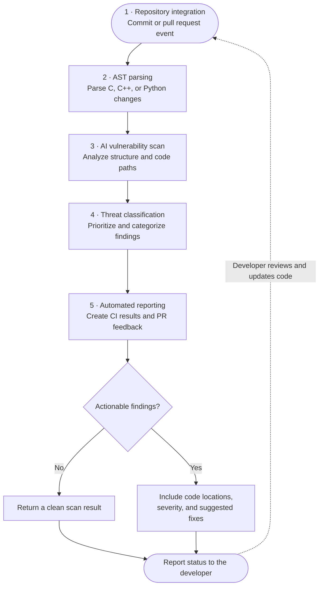

# CodeSentinel AI

**AI-assisted static security analysis for modern development teams.**

CodeSentinel AI is a security dashboard concept for identifying and triaging vulnerabilities in C, C++, and Python projects. The proposed product brings repository scanning and actionable findings into the pull-request workflow.

> **Project status:** This repository currently contains a self-contained frontend demo. Its dashboard, findings, filters, finding details, repository form, and simulated scan run in the browser. It does **not** connect to a Git provider, parse or scan source code, run a machine-learning model, or post pull-request comments. The diagrams below describe the proposed product architecture, not components already implemented in this demo.

## Why CodeSentinel?

Manual security reviews can slow down releases, while late discovery of vulnerabilities makes remediation more costly. Rule-based scanners can also return findings that are hard to prioritize. CodeSentinel is designed to help development teams review high-impact issues earlier and see clear explanations and suggested remediations alongside their code.

## Demo features

- A dark, responsive security dashboard with repository, finding, and risk summaries.
- Searchable findings and severity filters for critical, high, medium, and low issues.
- Finding details with example code, CWE references, and remediation suggestions.
- A repository form and an explicitly simulated scan experience.
- A proposed analysis pipeline for C, C++, and Python repositories.

### Run the demo

No package installation or backend is required. Open `index.html` in a browser, or serve this folder using a local static-file server. For example, with Python installed:

```bash
python -m http.server 8000
```

Then visit [http://localhost:8000](http://localhost:8000).

The scan and repository features are demonstrations only. Repository data and findings are sample data kept in the current page session.

## Proposed system architecture

The architecture below is the intended production direction, **not a claim that these backend services are present in this repository**.

```mermaid
flowchart LR
    Dev["Developer"] --> PR["Commit or pull request"]
    PR --> Provider["GitHub App or CI webhook"]

    subgraph Service["CodeSentinel scanning service · proposed"]
        Ingress["FastAPI webhook and API"]
        Queue[("Redis job queue")]
        Worker["Isolated scan worker"]
        Parser["Language-aware parsing<br/>C · C++ · Python"]
        Graph["AST and control-flow graph"]
        Model["Graph neural network<br/>and transformer analysis"]
        Triage["Finding classification<br/>severity · confidence · deduplication"]

        Ingress --> Queue --> Worker --> Parser --> Graph --> Model --> Triage
    end

    Provider --> Ingress
    Triage --> Results["Scan results"]
    Results --> Report["GitHub check run<br/>inline comments · patch suggestions"]
    Report --> PR
    Report --> Dev
```



### Architecture components

| Component | Proposed responsibility |
| --- | --- |
| Repository integration | Receive repository and pull-request events using a GitHub App, CI job, or webhook. |
| API and queue | Validate scan requests and schedule work through an asynchronous task queue. |
| Isolated scanner | Fetch the permitted revision into a short-lived worker and identify supported source files. |
| Language parsing | Build language-aware abstract syntax trees (ASTs) and, where supported, control-flow or data-flow graphs. |
| AI analysis | Evaluate code structure and vulnerability patterns using models trained and validated for the supported languages. |
| Finding triage | Normalize, classify, deduplicate, and prioritize findings with useful code locations and confidence information. |
| Developer feedback | Publish results as CI checks and, when configured, pull-request comments and actionable remediation suggestions. |

The proposed backend stack is Python and FastAPI, Redis for scan-job queuing, and containerized workers. Graph neural networks and transformer-based analysis are research and product goals; the dashboard's sample results are not generated by these models.

## Automated security-analysis flow

This five-stage flow follows the repository-integration-to-reporting process in the project brief.



## Planned capabilities

- **Languages:** C (ANSI/C99/C11), C++ (C++11–C++20), and Python.
- **Integrations:** GitHub App and Actions first; GitLab CI/CD and custom webhooks are planned.
- **Finding context:** File and line, category, severity, confidence, and practical remediation guidance.
- **Isolation:** Run repository analysis in scoped, short-lived containerized workers.
- **Performance goal:** Under 45 seconds for a typical incremental pull-request scan. This is a target, **not a benchmark of the current demo**.

## Suggested next steps

1. Design least-privilege GitHub App permissions and webhook validation.
2. Implement the API, durable scan-job lifecycle, and isolated source checkout.
3. Add parser and analyzer interfaces for each supported language.
4. Evaluate detection quality, model performance, and false-positive rates against labelled datasets.
5. Publish pull-request checks and comments only after authorization, validation, and integration testing.

## License

No license has been specified yet. Please confirm the project's licensing before redistribution or reuse.
